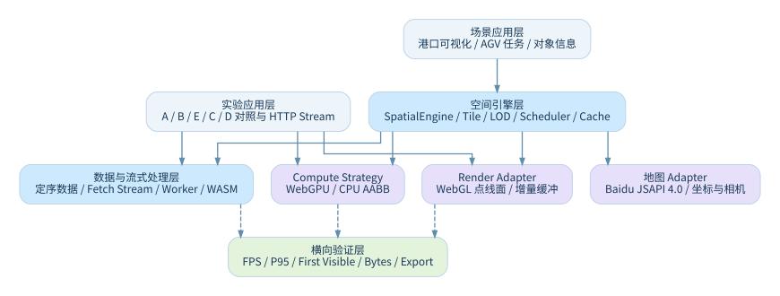

# 洋山港四期 · 海量空间数据可视化实验平台（V9）

**Baidu Map JSAPI 4.0 × WebGL × WebGPU × Worker/WASM × HTTP Streaming**

本作品研究 **50 万～100 万抽象空间对象**在地图上的分块加载、空间裁剪、绘制与性能对照。洋山港岸桥、155 辆 AGV、Gantry 和集装箱堆场是带空间约束的合成演示场景，**不是生产 TOS 或真实车道控制系统**。



## 立即体验

| 入口 | URL | 说明 |
|---|---|---|
| 港口主场景 | `http://localhost:5173/` | 百度地图 + 动态设备，**需要合法 AK** |
| 空间计算实验室 | `http://localhost:5173/lab.html` | 点/线/面/Mixed、A/B/E/C/D、HTTP 流，可离线 |
| 免 AK 场景预览 | `http://localhost:5173/port-preview.html` | 港口离线几何与设备运行预览 |
| 技术架构 HTML | `http://localhost:5173/architecture.html` | UTF-8 可直接阅读 |

```bash
npm ci
npm run typecheck
npm test
npm run dev
```

不安装 npm 也可在仓库根目录运行 `python3 -m http.server 4173`，打开 `http://localhost:4173/lab.html`（独立实验室）。

配置真实百度底图：在 `public/config.js` 配置有效且域名授权的 `baiduMapAk`。**勿提交私人密钥和账号凭证。**

## 技术亮点

- **分层 + Adapter**：地图、计算、渲染各司其职，WebGPU 不替换百度 SDK。
- **流式加载**：Worker 分块生成及真实 HTTP `ReadableStream` 两类实验，逐块上传 WebGL。
- **点线面真实绘制**：Point → `POINTS`；LineString → `LINES`；Polygon → `TRIANGLES`。
- **CPU/GPU 公平对比**：A、B、E、C、D 五组，E 为 CPU AABB 对照，C 为包含回读的 WebGPU 方案。
- **复杂动态压力场景**：155 AGV 按车、按任务独立规划；多对多 QC/Gantry 任务；模拟历史/全任务轨迹/点击高亮。

## 项目结构

`src/`：港口可视化与原空间引擎；`lab/`：可独立运行的空间性能实验室；`public/`：GLB、GIS、Tile、HTTP 大数据文件；`tests/`：自动化测试；`scripts/`：场景生成与测量；`docs/`：当前技术架构和实验协议；`submission/`：正式说明书与录屏脚本。

## 作品交付

- **作品介绍**：[V9 作品说明书 Markdown](submission/作品说明书_V9.md) · [PDF](submission/作品说明书_V9.pdf)
- **代码架构**：[设计模式与源码关系](docs/CODE_ARCHITECTURE.md)
- **评测方案**：[A/B/E/C/D 与可复现性](docs/BENCHMARK_REPRODUCIBILITY.md)
- **演示视频**：[分镜与讲解脚本](submission/演示视频脚本_V9.md) · **视频链接待录制后填写**
- **GitHub 仓库 URL**：`<填写你现有的 GitHub 仓库地址>`

## 验证边界

V9 原有 `npm run typecheck` 与 `npm test` 已通过：50 项 Node 测试，以及领域和数据源集成测试。**真实百度地图/WebGPU 浏览器性能仍须在你的硬件环境中完成；Node CPU/Worker 测试不得当成 GPU 加速结论。**

本仓库整理版删除了历史版本发布 MD 和重复临时说明，不对源码 API、依赖或 import 路径做破坏性改动。模型素材约 72 MB，若你已有 Git LFS 可考虑使用；`reports/` 的 JSON 是可复核的历史样本而非新 GPU 成绩。
