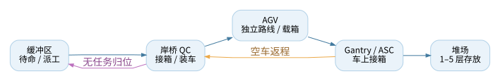
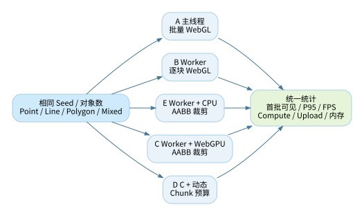

# 洋山港四期海量空间数据可视化实验平台

**基于百度地图 JSAPI 4.0、WebGL、WebGPU 的流式加载与空间计算性能研究**

**版本：V9 · 竞赛提交整理版**  
**作品类别：Web GIS / 海量空间数据 / 可视化性能实验**  
**代码仓库：**`<填写现有 GitHub 仓库 URL>`  
**演示视频：**`<完成录制后填写链接>`  
**资料性质：**项目源码审查与现有测试记录整理；不包含虚构的 GPU 加速结论。

> **一句话概括**：以洋山港四期为有约束的空间实验场景，利用百度地图提供地理底图和交互，通过 Worker/WASM、WebGL、WebGPU 及流式处理技术，对大量点、线、面对象的加载、计算、绘制和反馈调度开展可复现 A/B 性能实验。

## 执行摘要

这个作品不是一个真实的码头生产 TOS 管理系统。岸桥 QC、AGV、Gantry/ASC、标准集装箱与堆场是**空间数据及动态负载的来源**：它们使引擎既要处理密集静态对象，又要处理路线、实时移动、选择与状态更新。真正需要评价的，是异构 GPU 计算与地图融合方案在真实浏览器中的**端到端性能、可解释性及工程可复现性**。

V9 在实验系统之外保留一个港口场景 Demo：根据已有 GIS 几何构造模拟路网，对 155 辆 AGV 按车辆、按任务进行独立路径规划，展示多对多岸桥与 Gantry 运输、完整生命周期轨迹和点击高亮。该演示作为复杂空间环境，不应替代实验室中抽象 Point / LineString / Polygon 的受控试验。

| 已具备的能力 | 代码或数据证据 | 使用边界 |
|---|---|---|
| 百度地图与自定义图层融合 | `src/map/BaiduMap.ts`、`BaiduWebGLLayerAdapter.ts`、`lab/map.mjs` | 使用 4.0 兼容入口，真实 AK 环境仍需验证 |
| 抽象点线面渲染 | `lab/dataset.mjs`、`lab/renderer.mjs` | 点、线、面分别走 `POINTS` / `LINES` / `TRIANGLES` |
| Worker / WebGPU / CPU 对照 | `lab/benchmark.mjs`、`lab/gpu.mjs` | WebGPU 不支持时必须报告不可测 |
| HTTP 真流式演示 | `lab/http-stream.mjs`、`lab/stream-codec.mjs` | 静态 HTTP 文件的 `ReadableStream`，非真实 TOS 推送 |
| AGV 个体路径规划 | `AGVFleetRuntime.ts`、`YangshanPhase4Network.ts` | 路网由现有 GIS 派生，不能作为实际车辆导航 |
| 测试与结果导出 | `tests/`、`reports/*.json` | Node 生成性能 ≠ 浏览器渲染性能 |

## 1. 项目背景与问题定义

### 1.1 背景

大型港口的地图场景往往同时包含大规模集装箱堆存、轨道设备、AGV 路线和持续变化的车辆位置。如果直接把所有数据一次性下载、解析并绘制，容易造成浏览器主线程长任务、首屏等待、临时内存峰值和地图交互卡顿。单纯增加 WebGPU 计算代码，也不代表整体速度必然更快，因为 WebGPU 计算结果回读 CPU 再交给 WebGL 仍可能引入同步与复制成本。

### 1.2 作品拟解决的核心问题

1. **加载**：50 万～100 万抽象空间对象能否分块到达、增量解码并尽早显示？
2. **几何**：Point、LineString、Polygon 是否真正使用相应 GPU 图元，而不是全都画成点？
3. **计算**：同一视口、相同数据条件下，CPU AABB 与 WebGPU AABB 谁的**端到端**耗时更低？
4. **融合**：百度地图缩放、拖动及摄像机变化时，自定义 WebGL 图层能否正确对齐且保持可见？
5. **控制**：根据分块耗时和渲染负载反向调整 Chunk 预算，能否改善 P95 帧耗时与主线程响应？
6. **可验证性**：如何把可见对象数量、GPU 回读成本、首批可见时间和实验环境记录下来，避免只展示 FPS 一个数字？

### 1.3 项目边界

本项目使用**合成空间数据、模拟设备运行状态和现有 GIS 边界**构建实验。未提供真实车道中心线、堆场轨道中心线或生产设备调度系统接口，因此不对车辆路线、设备安全、工业级无死锁或真实港口吞吐率作承诺。

## 2. 业务场景结构：为技术实验服务



### 2.1 场景实体与技术研究的对应关系

| 场景对象 | 场景行为 | 对应的数据结构 | 被测技术能力 |
|---|---|---|---|
| QC 岸桥 | 接箱、向 AGV 装箱 | 稀疏设备点 / GLB | 地图坐标、模型朝向及对象选中 |
| AGV | 路线规划、运动、避让、历史记录 | 动态点 + 折线 | 高频更新、路径绘制、增量 Buffer |
| Gantry / ASC | 轨道内往返、车上接箱、堆箱 | 轨道线 + GLB | 模型位置、边界约束、动态位移 |
| 集装箱 | 标准箱位与 1～5 层堆叠 | 高密度面 / 实例 | 密集加载、LOD、剔除与批处理 |
| AGV 缓冲区 | 无任务停车、分散派发 | 区域面 + 停车位 | 空间布局、可视范围改变 |
| GIS 道路 / 作业边界 | 定义约束与辅助路网 | 线、面几何 | 空间裁剪与碰撞边界查询 |

### 2.2 简化进口卸船链路

1. AGV 在缓冲区待命并领取模拟任务。
2. AGV 按自身当前位置与任务目标独立规划，前往指定 QC。
3. QC 将标准集装箱装到 AGV 上；载箱 AGV 驶向可达 Gantry 交接位。
4. Gantry 从车上接箱并移到堆场目标箱位，不将箱子虚拟卸在海侧地面。
5. AGV 空车返回岸桥；若有下一任务则重新规划，否则驶回缓冲区停车。
6. 系统保留每辆车的完整任务路线和历史采样，可点击设备查看模拟属性。

**重点说明：**以上顺序是港口作业的**实验场景语义**，不是另起一个完整 TOS 微服务平台。V9 中以前引入的 TOS 领域模块作为**可选演示插件**，默认不初始化，需使用 `/?business=1` 才启用。

### 2.3 V9 的 AGV 规划特征

V9 基于既有 `agv_routes_gis.json` 与 `port_layout.json`，在岸桥节点及 Gantry 交接路径构成的图上搜索路线；单车路径代价结合距离、走廊占用和拥堵启发。每辆 AGV 持有独立规划 ID，连续任务从上一任务结束的当前位置续接。车辆运动仍使用速度、加速度、转向限速与车辆外廓避让约束。历史轨迹包括带来源标记的**模拟历史**和运行时采集，不得表述为真实 GPS 记录。

原 V8 的初始分布目标为 Gantry 端 39 辆、Gantry 侧缓冲/通道 46 辆、岸桥侧 70 辆。这是开场**模拟快照**，车辆运行后不保持固定比例；接近 80% 的派工/移动目标也受交通等待影响，不能强制视作实时移动比例。

## 3. 总体代码架构与边界

### 3.1 架构原则

采用**分层架构（Layered Architecture）**组织职责，按功能使用 **Adapter、Pipeline、Strategy、Observer/事件订阅与有限状态机**。核心约束为：**场景依赖空间引擎，空间引擎不依赖洋山港业务**。业务对象变化只作为空间引擎的输入数据，而非直接控制底层 WebGPU 资源。


### 3.2 两套运行入口：为什么要分开

**A. 港口场景 `/`：** `src/main.ts` 创建 `PortApplication`，经 `BaiduMap`、`SpatialEngine` 和 `BaiduWebGLLayerAdapter` 渲染港区；AGV Runtime 负责模拟、路网规划与轨迹。此入口以“复杂真实感场景与交互展示”为目标，需要百度 AK。

**B. 空间实验室 `/lab.html`：** `lab/main.mjs` 协调 `dataset`、`benchmark`、`gpu`、`renderer` 与 `map`，可离线使用；通过受控生成的抽象点线面数据实施 A/B/E/C/D 对照，真实百度底图由用户明确启用。

**关键实现边界**：实验室的数据生成/分块/绘制链路与港口场景 `SpatialEngine → Tile/Worker/WASM` 链路仍是**两个可运行但不完全统一的执行路径**。不能把实验室的所有性能特性写成主场景已经具备，亦不能把港口模型绘制 FPS 当作抽象点线面实验结果。

### 3.3 数据流与控制反馈

**主数据流（单向）**：数据集或 HTTP → 流式解码/Worker → 可选空间裁剪 → TypedArray → WebGL `bufferSubData` → 点/线/面绘制。  
**控制反馈（反向）**：Worker 回执、渲染帧耗时、上传时间、视角变化 → 调整分块预算/取消任务/触发重绘。

对于 WebGPU 路径，当前是“WebGPU Compute → visibility 回读 → CPU compact → WebGL 上传”。这是**异构 API 融合原型**，不是零拷贝 WebGPU/WebGL Buffer 共享，必须把回读和 CPU 压缩也计入加速评估。

## 4. 实际源码目录结构

以下按**清理后的 V9 GitHub 目录**组织，不为美观而改动 TypeScript 的 import 路径。

```text
./
├── README.md                   # GitHub 项目首页，统一的 V9 入口
├── index.html / lab.html       # 港口主场景 / 空间计算实验室
├── src/
│   ├── main.ts                 # 主场景启动与百度 JSAPI 加载
│   ├── app/                    # PortApplication 应用协调
│   ├── engine/                 # SpatialEngine：Tile/LOD/调度统筹
│   ├── map/                    # BaiduMap + WebGL 图层适配
│   ├── data/
│   │   ├── pipeline/           # 流程编排
│   │   ├── scheduler/          # 任务调度
│   │   ├── source/             # GIS/TOS/Tile/AGV 数据源
│   │   ├── runtime/            # AGVFleetRuntime、SpatialBuffer
│   │   └── format/             # 数据格式适配
│   ├── renderer/webgl/         # 点、线、面及港口模型绘制
│   ├── renderer/webgpu/        # WebGPU Compute 与 WGSL
│   ├── spatial/                # Quadtree、SpatialTileSelector
│   ├── worker/ / wasm/         # WorkerPool、协议及 WASM 适配
│   ├── simulation/yangshan/    # 场景几何与合成路网
│   ├── gis/                    # 坐标与空间约束
│   ├── presentation/           # 对象点击属性 / 可选业务插件
│   ├── application/ / domain/  # 可选 TOS 场景领域模块
│   └── infrastructure/        # 模拟/远程 TOS Adapter
├── lab/
│   ├── main.mjs                # 实验室 UI 与导出
│   ├── benchmark.mjs           # 五组对照编排 / 指标采样
│   ├── dataset.mjs             # 可复现抽象几何生成
│   ├── dataset.worker.mjs      # Worker 数据块生成
│   ├── renderer.mjs            # POINTS / LINES / TRIANGLES
│   ├── gpu.mjs                 # WebGPU AABB 与读回
│   ├── map.mjs                 # 离线/百度地图 Adapter
│   ├── http-stream.mjs         # Fetch ReadableStream 示例
│   └── stream-codec.mjs        # 二进制流增量解析
├── performance/                # 主场景旧基准及监控工具
├── public/
│   ├── assets/                 # 岸桥、Gantry、AGV GLB
│   ├── data/gis/               # 港区边界与 GIS 基础数据
│   ├── data/simulation/        # 任务与动态轨迹合成数据
│   ├── data/tiles/             # Tile 样例资源
│   ├── data/lab/               # 100 万对象 HTTP 样例数据
│   └── port-preview.html       # 无 AK 预览入口
├── scripts/                    # 场景生成、构建、测量脚本
├── tests/                      # Node 单元/几何/规划回归
├── wasm-src/                   # WASM C++ 实现源码
├── reports/                    # 可复核的 JSON 测量记录
├── docs/                       # 当前架构与实验协议
└── submission/                 # 本作品说明书及视频录制脚本
```

### 4.1 代码模块之间的“谁调用谁”

| 入口 / 模块 | 直接职责 | 最重要的调用关系 |
|---|---|---|
| `src/main.ts` | 加载百度 JSAPI、异常提示 | `new PortApplication(...).initialize()` |
| `PortApplication.ts` | 地图、空间引擎、监控器协调 | 调用 `BaiduMap`、`SpatialEngine`、`StreamingBenchmark` |
| `SpatialEngine.ts` | 创建 Worker/数据 Pipeline、TileSelector、WebGPUCompute、Overlay | 相机变化时更新可见 Tile 并触发重绘 |
| `AGVFleetRuntime.ts` | 按车维护任务、状态、规划、避让、历史记录 | 接收 GIS 路网及任务，输出运行时 AGV 状态 |
| `YangshanPhase4Network.ts` | 提供可用合成 QC–Gantry 连接拓扑 | 供 AGV 路径算法计算候选和成本 |
| `AGVWorldOverlay.ts` | 叠加设备、堆场、全部路线与选中高亮 | 消费 AGV 状态，不负责实际任务分配 |
| `lab/benchmark.mjs` | 统一实验变量、执行模式和采样 | 调用 Dataset Worker、Compute Adapter、Renderer |
| `lab/renderer.mjs` | TypedArray 展开与 WebGL 绘制 | 每类几何调用对应 GPU 图元 |
| `lab/http-stream.mjs` | HTTP 读取、逐批解码、绘制进度 | 调用 `SpatialRecordDecoder` 和 `PortRenderer` |

### 4.2 资源与配置

`public/config.js` 默认 AK 为空，以避免提交私人凭证。实际访问百度地图需填写合法 AK 与可用域名；离线实验室不需要 AK。`public/assets/agv/agv.glb` 约 72 MB，建议 GitHub 使用 Git LFS（先确认团队支持）；大模型和合成样例数据是运行资源，不能为了缩小仓库直接删掉。

## 5. 设计模式及为什么这样用

### 5.1 分层架构（总体结构）

- **展示层**：港口地图、空间实验室、属性面板。
- **应用编排层**：`PortApplication`、`LabBenchmark` 负责生命周期与实验命令。
- **数据与空间引擎层**：Tile/LOD、Worker、WASM、几何、缓存与路线规划。
- **外部能力适配层**：Baidu Map、WebGL、WebGPU、数据源与远程 TOS。
- **验证层**：Benchmark、JSON/CSV、Node 测试和环境记录，横向贯穿。

分层不等于所有东西必须位于同一个 `src` 子树：实验室保留独立的 ES Module 入口，是为了降低测试启动和复现成本。

### 5.2 Adapter 模式（异构技术隔离）

`lab/map.mjs` 封装地图变换与视口；`lab/gpu.mjs` 提供 Compute 接口；`lab/renderer.mjs` 封装 WebGL 缓冲与图元绘制。**百度 JSAPI 与 WebGPU 并非同一种 Adapter 的两个互换实现**：JSAPI 提供地理底图和相机，WebGPU 提供可选并行计算，WebGL 负责屏幕绘制。

### 5.3 Pipeline 模式（分块数据流）

实验路径：`generateChunk` / `fetch.body.getReader()` → TypedArray → AABB（可选）→ compact → `bufferSubData` → draw / RAF。分块解析必须能正确处理对象二进制记录跨越网络 chunk 边界的情况，具体由 `SpatialRecordDecoder` 实现。

### 5.4 Strategy 模式（公平对照）

A/B/E/C/D 使用相同对象生成、对象数量、随机种子、几何类型及渲染器，只切换数据生产和裁剪/预算策略。**E（CPU 裁剪）是 C（WebGPU 裁剪）的关键对照组**，避免把“裁剪后少画对象”的收益错归因给 WebGPU 算法。

### 5.5 Observer / 控制反馈与 AGV 状态机

地图相机变化触发可见 Tile 更新、Overlay 重绘；实验时每块完成后再请求下一块，D 组根据上一块总耗时调整 Chunk；AGV 的停车、装载、运输、返回等状态控制是否派工和如何计算路线。可视化状态由业务场景或模拟事件投影而来，**地图画面中的到达动作不能代表实际 TOS 已确认交接**。

## 6. 点、线、面与流式加载实现

### 6.1 抽象测试几何

| 几何类型 | 实验名称 | 主要 GPU 图元 | 数据规模 |
|---|---|---|---|
| 点 | Point | `gl.POINTS` | 1 万 / 10 万 / 50 万 / 100 万 |
| 线 | LineString | `gl.LINES` | 同上，逐对象展开线段顶点 |
| 面 | Polygon | `gl.TRIANGLES` | 同上，逐对象展开填充三角形 |
| 混合 | Mixed | 按实际类型分别提交 | 同上 |

测试对象“数量”不是 GPU 顶点数量；线和面经过展开，上传字节数与绘制顶点数会增加，因此对比时应同时报告 `objectCount`、`vertexCount`、`uploadBytes` 与 `drawCalls`。

### 6.2 真正的 HTTP 流式与 Worker 分块是两个实验

- **HTTP Stream**：浏览器读取 `public/data/lab/abstract_mixed_1m.ysl`，`fetch(...).body.getReader()` 不断接收数据；跨块补齐后增量解析并上传 WebGL。支持调整显示延迟以观察逐批渲染，但人为延迟不是网络性能。
- **Worker Benchmark**：可复现的客户端数据块由 Worker 生成，主线程按需接收、处理和绘制。它验证主线程负载转移/背压，而不代表网络数据是从服务器流过来的。

为体现竞争点，应在视频中展示加载进度、接收字节、读取次数、上传批次、首次可见时间及点线面累计数，避免只录最终结果。

## 7. A/B/E/C/D 实验设计



| 实验组 | 数据生产 | 裁剪策略 | 绘制 | 用于回答的问题 |
|---|---|---|---|---|
| A | 主线程 | 无 | 末尾批量展示 | 单线程基线如何表现？ |
| B | Worker | 无 | 逐块 WebGL | 以数据流换取响应性的成本是什么？ |
| E | Worker | CPU AABB | 逐块 WebGL | 裁剪本身带来多大收益？ |
| C | Worker | WebGPU AABB | 逐块 WebGL | 含回读的 GPU 方案比 E 快吗？ |
| D | Worker | WebGPU AABB + 自适应分块 | 逐块 WebGL | 反馈式调度能改善 P95 吗？ |

### 7.1 固定的控制变量

建议先用 `10k → 100k → 500k → 1m` 顺序压测，固定随机种子、几何类别、Chunk 初始大小、地图/视口、浏览器和显卡。在**同一设备每组至少 5 次**，交换执行顺序并记录中位数及 P95；并分别测试离线地图和真实百度 JSAPI 模式。WebGPU 不可用时记为 **N/A**，不能自动当作 CPU C 组成绩。

### 7.2 实验指标与公式

- **加载耗时** `loadTimeMs`：从开始运行到输入对象处理完成并经过指定绘制帧的墙钟时间。
- **首批可见近似时间** `firstVisibleMs`：首次 `draw` 提交时的经过时间；不保证该时刻像素已完成合成。
- **P95 帧耗时** `frameP95Ms`：`requestAnimationFrame` 帧间隔序列的第 95 百分位。
- **处理吞吐量** `objectsPerSecond = 输入对象数 / (loadTimeMs/1000)`。
- **端到端加速比** `speedup = T_baseline / T_candidate`，小于 1 即候选方案变慢。
- **Compute**：包含上传与 `mapAsync` 回读的总墙钟时间，不等于纯 Shader 时间。
- **Upload**：同步 `bufferSubData` 调用耗时，不能直接等同 GPU 真正执行时间。
- **内存**：可获取时统计 JavaScript Heap；不宣称它就是 VRAM。

### 7.3 已有实测（Node；仅限生成链路）

历史记录 `reports/node-data-benchmark.json` 的测量环境为 Linux x64、Node 22.16、AMD EPYC 9V74（分配 5 个逻辑核）、种子 20261016、8192 对象分块、每组 3 轮。以下是三轮中位数：

| 输入数 | 主线程生成 | Worker 生成及串行回复 | 解释 |
|---:|---:|---:|---|
| 10,000 | 1.85 ms | 43.34 ms | 小任务的 Worker 启动成本突出 |
| 100,000 | 6.71 ms | 53.54 ms | Worker 仍然更慢 |
| 500,000 | 37.31 ms | 84.29 ms | 仅对生成/消息耗时有意义 |
| 1,000,000 | 60.10 ms | 122.28 ms | 不能外推到浏览器 FPS |

V6 另有 100 万记录、9,000,012 字节静态 HTTP 流完整解析的历史记录，证明网络分块读取与记录重组功能可以运行；不同网络和设备下的耗时需要重新测量。

**当前尚未得到的证据**：真实 JSAPI 4.0 地图叠加后 WebGPU 与 CPU 的有效加速比、50 万/100 万线面对象的 GPU 帧率、浏览器 GPU 显存占用。文档与答辩中这些均标为**待本机测量**，绝不伪造。

## 8. 创新点及其可验证证据

### 创新点一：异构 API 的责任分离

Baidu JSAPI 作为地图 Adapter，WebGL 负责图元和模型显示，WebGPU 作为独立计算 Strategy。这不是“WebGPU 替换地图 SDK”，而是让同一地图环境可比较 CPU 与 GPU 的裁剪决策。**证据**：`lab/map.mjs`、`gpu.mjs`、`renderer.mjs`；待完成真实地图渲染对齐截图。

### 创新点二：可观察、可控的双路径流式机制

将真实 HTTP ReadableStream 与 Worker 分块机制分开，分别展示网络数据边界、解码/上传批次以及反向背压控制。**证据**：`http-stream.mjs`、`stream-codec.mjs`、`benchmark.mjs`、分片边界单元测试。

### 创新点三：点线面统一的公平 Benchmark

统一数据和 WebGL Renderer，使用 CPU AABB（E）为 WebGPU AABB（C）提供直接对照，再以 D 分析反馈预算收益。**证据**：五组配置、固定种子、导出的 JSON/CSV、真实 GPU 设备记录。

### 创新点四：兼具空间约束的动态复杂场景

155 辆 AGV 在现有 GIS 派生路网上每车每任务独立规划，并显示完整任务轨迹；标准集装箱堆放、Gantry 占地约束和点击属性提供视觉与功能压力。**证据**：V9 规划测试、港区几何测试、实例场景视频。不得将合成路网包装成真实生产级调度。

## 9. 运行、验证和复现步骤

### 9.1 前置条件

建议 Node.js 22、支持 WebGL 的现代浏览器、Python 3（用于免 npm 静态服务）。WebGPU C/D 需支持 `navigator.gpu` 的浏览器与可用 GPU 设备；百度地图模式需合法 JSAPI AK 和匹配的域名授权。

### 9.2 本地运行

```bash
npm ci
npm run typecheck
npm test
npm run dev
# 港口主场景：http://localhost:5173/
# 技术实验室：http://localhost:5173/lab.html
```

**无需 npm 的离线实验室：**

```bash
python3 -m http.server 4173
# http://localhost:4173/lab.html
# http://localhost:4173/port-preview.html
```

### 9.3 真实百度底图设置

将 `public/config.js` 的示例 `baiduMapAk` 替换为自己申请且授权的 AK。若必须避免发布 AK，可在发布前注入相应运行时配置；不要把云端密钥或企业数据放入仓库。实验室不配置 AK 仍可离线展示全部抽象点线面数据。

### 9.4 自动化检查范围

本次从清理前 V9 工程**实际重新执行**：`npm run typecheck` 通过；`npm test` 共 50 项 Node 测试全部通过，另有领域状态机和数据源集成测试通过。清理后的仓库将再次运行相同命令，检查并修复测试中的文档路径耦合。**这不等于浏览器生产构建或 GPU 验收。**

## 10. GitHub 仓库及提交组织

建议在你现有的 GitHub 仓库中使用独立分支 `release/v9-competition` 导入本整理版，待审查后合并。不要直接删除线上仓库历史；本次所谓“清理”仅指**新的提交工作树中不再保留重复版本 README、历史发布 MD、过期架构说明与无引用副本**，Git 的历史提交仍然可追溯。

清理后的文档只有一个主 README、一个正式作品说明、一个技术源码索引、一份性能实验说明以及一份视频脚本。源代码路径未做破坏性的整体迁移。旧测量 JSON 保留以便复核，旧测试日志及旧版本说明不再作为提交材料。

**GitHub 首页应展示**：作品一句话定位、结构架构图、Demo 截图、启动命令、实验入口、当前测试事实、PDF 作品说明、视频链接（待录制填入）、数据合成与性能边界。

## 11. 演示视频建议（4～6 分钟）

| 时间段 | 镜头与操作 | 应展示的证据 |
|---|---|---|
| 0:00–0:35 | 课题与架构图 | 技术核心：JSAPI × WebGL/WebGPU |
| 0:35–1:35 | 港口主场景：岸桥、Gantry、五层箱堆、155 辆 AGV | 整体地图、彩色全任务路线 |
| 1:35–2:20 | 点击某车、切换任务、查看单车详情与完整历史 | 规划 ID、任务阶段、历史样本来源 |
| 2:20–3:10 | 独立实验室 Point / LineString / Polygon / Mixed | GPU 对应图元，规模切换 |
| 3:10–4:00 | HTTP Stream：100 万对象分批出现 | 网络字节、分块批次、首批可见时间 |
| 4:00–5:10 | A/B/E/C/D 对照并导出 JSON/CSV | 同种子、P95、Compute+回读的公平比较 |
| 5:10–5:40 | 结论和限制 | 已实测 vs 待测、不假定 GPU 必然加速 |

视频需现场真实录制，建议画面包含浏览器地址栏、实验参数与导出的报告文件。若 WebGPU 不可用，则记录原因并如实说明，不能剪辑成已经获得 C/D 成绩。

## 12. 局限性及后续研发

1. **浏览器验收**：在配置合法百度 AK 和真实 GPU 的本机复核地图对齐、GLB 方位、Canvas 层级与点击命中。
2. **性能实验**：50 万/100 万抽象点线面在相同设备各 5 轮，建立稳定的首批可见、P95 帧耗时和吞吐表；WebGPU 与 CPU 结果对照。
3. **增量 Tile 集成**：将实验室已验证的 chunk 机制逐步接入主 `SpatialEngine` Tile 路径，使两套运行时共享一个正式 Buffer 管理器。
4. **动态剔除正确性**：相机移动后，对首次被剔除的对象进行二次查询与正确回填；当前 C/D 更适合固定视角对照。
5. **交通真实度**：需要真实车道拓扑、通行方向及设备轨道数据后，才能进一步声称道路级可达性与防死锁调度。
6. **模型与仓库体积**：评估 3D 模型压缩、LOD、实例化及 Git LFS，避免所有访问者都下载高精度模型。

## 13. 结论

V9 的价值在于把“港口复杂数据场景”和“可控可复现的空间技术实验”放在同一作品中，同时保持各自的边界。通过分层架构、地图/计算/渲染 Adapter、分块 Pipeline、计算 Strategy 与反馈调度，在代码上实现了可解释的实验方案；通过单车路径规划和设备点击交互提供了有说服力的场景负载。

真正的竞赛高分证据应来自**真实百度 JSAPI 地图 + 真实浏览器 GPU + 同环境 A/B/E/C/D + 50 万与 100 万点线面实测报告**。现有自动化通过情况应当陈述，但不能代替上述 GPU 测量。

---

### 附录 A：源码与实验依据

- 工程源码：`src/`、`lab/`、`scripts/`、`tests/`、`wasm-src/`。
- 港口边界与模拟数据：`public/data/gis/`、`public/data/simulation/yangshan_phase4/`。
- 真实 HTTP 样例：`public/data/lab/abstract_mixed_1m.ysl`。
- 性能原始记录：`reports/node-data-benchmark.json`、`reports/v5_abstract_geometry_node_measurements.json`。
- 设备字段词典：原用户提交的《洋山四期自动化码头关键设备作业记录数据集数据说明》，提供 `TSC_*`（岸桥）、`TAA_*`（AGV）、`TAC_*`（ASC）字段说明；附件为字典，并非实际作业记录 CSV。

### 附录 B：本作品非目标

本作品不承担生产港口交通安全认证、设备远程控制、真实码头 TOS 部署、真实 GPS 定位、设备故障安全联锁或海事业务合规审计。
